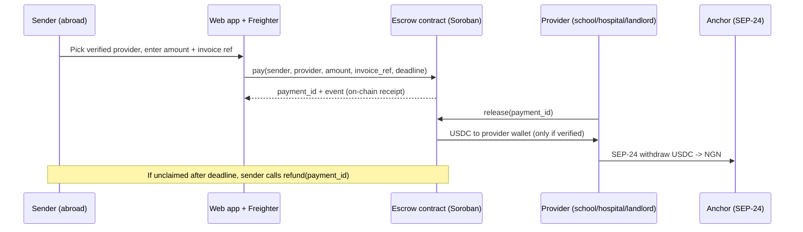

# Tech stack

Platform: **web** (Next.js, mobile-responsive). A React Native app is a post-hackathon next step.

| Layer | Choice | Why |
|---|---|---|
| Smart contract | Rust + Soroban SDK (`soroban-sdk`), target `wasm32v1-none` | Stellar's native smart contract platform |
| Contract tooling | Stellar CLI 30.x (`stellar contract build/deploy/invoke/bindings`) | Build, deploy, and generate TS clients |
| Network | Stellar **testnet** (Soroban RPC + Horizon) | Free, fast, Friendbot funding |
| Asset | Testnet USDC (Circle faucet) or a self-issued test asset via its Stellar Asset Contract (SAC) | Stablecoin payments |
| Frontend | Next.js (App Router) + TypeScript + Tailwind CSS | Existing strengths, fast to ship |
| Wallet | Freighter (`@stellar/freighter-api`), optionally Stellar Wallets Kit | Sign transactions in browser |
| Chain SDK | `@stellar/stellar-sdk` + generated contract bindings (`stellar contract bindings typescript`) | Typed contract calls |
| Cash-out | SEP-10 (auth) + SEP-24 (interactive withdraw) against `testanchor.stellar.org` | Naira off-ramp flow for the demo |
| Explorer | Stellar Expert (testnet) | Receipt / transaction links |
| Hosting | Vercel | One-command deploys |
| Package manager | pnpm | |

## Repo layout

```
contracts/escrow/   Soroban escrow contract + tests
web/                Next.js app (sender, provider, admin, receipt pages)
docs/               Plan, stack, architecture
```

## Architecture



## Contract interface

Admin and token are set by the constructor at deploy time (no separate `init`):

```
stellar contract deploy --wasm target/wasm32v1-none/release/escrow.wasm \
  --source alice --network testnet --alias escrow \
  -- --admin <G...admin> --token <C...usdc_sac>
```

Admin (admin signs)
- `register_provider(provider, name, category)`: category is School, Hospital, Landlord or Other
- `remove_provider(provider)`: errors with `ProviderNotFound` if never registered

Sender / provider
- `pay(sender, provider, amount, invoice_ref, deadline) -> u64`: sender signs; provider must be verified; deadline must be 3 to 30 days from now
- `release(id)`: provider signs; only on or before the deadline; pays only the registered provider
- `refund(id)`: sender signs; only after the deadline and only if still pending

Views
- `get_payment(id)`, `get_provider(addr)`, `is_verified(addr)`, `payment_count()`, `token_address()`, `admin_address()`

Typed events (`#[contractevent]`): `ProviderAdded`, `ProviderRemoved`, `Paid`, `Released`, `Refunded`.

Storage: payments, providers and instance data have their TTL extended to ~60 days on every write and on pay/release. Deadlines are capped at 30 days so records outlive them.

## Web app notes
- Provider pending list: loop `get_payment(1..=payment_count())` and filter by provider. RPC only keeps events for a short window, so don't rely on events for history.
- Receipt page: read `get_payment(id)` plus the transaction link on Stellar Expert.
